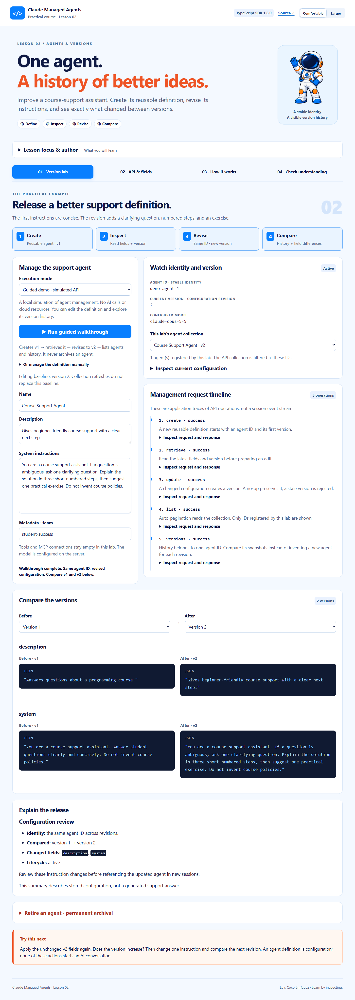

# Lesson 02 — Claude Managed Agents: Agent Version Lab

A practical companion to **Lesson 2: Agents and Versions**, by **Luis Coco Enríquez**.

Create a course-support definition, improve its instructions, and explain the change through its version history. The lab demonstrates a stable agent ID, changing configuration versions, no-op updates, optimistic concurrency, and deliberate terminal archival.



## Start here

Requires Node.js 24 LTS (Node 22.14+ supported), npm, and Git.

```sh
git clone https://github.com/luiscoco/claude-managed-agents-lesson-02.git
cd claude-managed-agents-lesson-02
npm ci
npm run dev
```

Open **http://127.0.0.1:4322**. Lesson 1 uses port 4321, so both applications can run together.

The **guided demo requires no API key**. It is an explicit local simulation of management operations, not AI inference or a cloud run. Unlike a fixed answer replay, its in-memory provider lets students edit definitions, create revisions, test no-op updates, and archive demo agents.

## Four teaching activities

1. **Version lab:** run the guided lifecycle, edit the support definition, inspect request/response JSON, compare field snapshots, and explain the release.
2. **API & fields:** six core methods and nine configuration/status concepts, each with an expandable, syntax-highlighted TypeScript example.
3. **How it works:** UML architecture, an activity workflow with responsibility swimlanes, eight selectable workflow steps, setup guidance, and a complete runnable example.
4. **Check understanding:** six questions with feedback and a practical challenge.

The interface preserves Lesson 1’s visual style: pale blue page, navy text, orange emphasis, blue controls, rounded panels, the course astronaut, and Comfortable/Larger reading controls. Code uses the same syntax colors everywhere. Explanatory rich text is rendered and sanitized; user configuration remains literal text inside highlighted JSON. Desktop and mobile layouts support keyboard navigation and visible focus.

## Follow the practical example

Click **Run guided walkthrough**. It performs these management operations:

| Action   | Observation                                                       |
| -------- | ----------------------------------------------------------------- |
| Create   | A new course-support agent begins at version 1                    |
| Retrieve | Read the current baseline and expected version                    |
| Update   | Improved instructions produce version 2 with the same agent ID    |
| List     | Browse the collection; this host displays only its registered IDs |
| Versions | Compare the description and system instructions in v1 and v2      |

Expand **Or manage the definition manually**, then:

- Apply the unchanged fields again: the current version is preserved.
- Change one instruction and apply it: a new revision appears.
- Select any two snapshots to inspect actual field differences.
- Create a separate agent to demonstrate the difference between a new ID and a new version.
- In demo mode, expand the retirement panel and type the selected agent’s exact name to explore archival.

The walkthrough **never archives automatically**. Archival cannot be undone. It makes the agent read-only and prevents new sessions from referencing it; existing sessions continue. The pinned agent interface has archive rather than delete/unarchive operations.

The “Explain the release” panel is derived from the selected configuration snapshots. It is **not an AI-generated support answer** and does not establish whether revised instructions produce better model behavior. Evaluate that separately in an appropriate session workflow.

## Optional live management

Copy `.env.example` to `.env`:

```powershell
# Windows PowerShell
Copy-Item .env.example .env
```

```sh
# macOS / Linux
cp .env.example .env
```

Set your own Managed Agents-enabled Anthropic credential and an available model:

```dotenv
ANTHROPIC_API_KEY=your_key_here
ANTHROPIC_MODEL=claude-opus-5-5
PORT=4322
```

Restart Node and select **Live · Claude Managed Agents**. Actions now create and manage real cloud definitions through the official **`@anthropic-ai/sdk` 1.6.0**. Live updates pass the retrieved `version`, so stale edits return 409 instead of silently overwriting another revision. Retrieve the latest configuration and review changes before retrying.

The editor displays its baseline version separately from the current collection snapshot. Refreshing the collection does not replace that editing baseline. Use **Retrieve latest configuration** to review and adopt another editor’s revision. Use **Prepare a fresh definition** to start another agent, including after an earlier one has been archived.

All AI platform operations use **Claude Managed Agents**. There is no Claude Agent SDK, local agent runtime, alternate AI service, or Messages API agent loop. This lesson calls **agent management endpoints only**: it does not create environments, start sessions, or make model inference requests.

The server owns the API key. It is never bundled into browser code or saved to browser storage. Created live agent IDs are registered in ignored `.data/agents.json`; the file stores **IDs only**. After restarting the server, choose live mode and use **Refresh agent collection** to load those registered agents. Only lab-registered IDs are editable or archivable through this UI. The application does not adopt or mutate unrelated account agents.

No `.env`, account data, or Git history was copied from Lesson 1. Supply a key explicitly for this application. Do not commit credentials.

## Core concepts and correct field placement

- **Agent ID:** stable identity of a reusable definition.
- **Version:** revision of that configuration, starting at 1; changes create a new revision, no-ops do not.
- **System instructions:** reusable behavior, distinct from a session’s user message.
- **Tools / MCP servers:** capability configuration; arrays are replaced when supplied. This lab leaves both empty.
- **Metadata:** organizational key-value tracking. API updates merge keys and allow null to delete a key.
- **Policies and limits:** tool permissions belong to tool configuration; network settings belong to environments; a session can carry a budget. The slide’s general policy concept is not an invented `execution_policy` field in agent payloads.
- **History:** the UI inspects snapshots. Selecting an old version is not an automatic rollback.
- **Beta status:** `managed-agents-2026-04-01` is sent automatically by the pinned SDK’s managed agent endpoints. Beta does not mean deprecated.

Agent listing and version listing use `for await` to follow the SDK’s cursor pagination. The host filters account-level agent results to its ownership registry before returning the collection to the browser. API traces here are management request/response records, **not session events**.

## Code layout

```text
src/client/main.ts          Editor, trace view, comparisons, method/field map, quiz
src/client/formatting.ts    Safe rich text and shared syntax highlighting
src/client/workflow.ts      Native SVG UML diagrams and interactive step guide
src/server/index.ts         Local HTTP API and Vite/production host
src/server/lab.ts           Validation, ownership, demo and live SDK adapters
src/shared/lesson.ts        Lesson-specific content, types and examples
src/examples/agent-lifecycle.ts  Standalone live management example
test/                      Domain, SDK transport and desktop/mobile browser checks
```

See [the instructor guide](docs/instructor-guide.md), [visual style](docs/visual-style.md), and [validation record](docs/validation.md).

## Commands

| Command            | Purpose                                                     |
| ------------------ | ----------------------------------------------------------- |
| `npm run dev`      | Local application with Vite UI updates                      |
| `npm run check`    | Type checks, backend/SDK tests, and production build        |
| `npm run build`    | Build the client and Node server                            |
| `npm start`        | Serve the production build on loopback port 4322            |
| `npm run test:e2e` | Desktop/mobile browser checks against the built app         |
| `npm run example`  | Create/update a **real** agent using the standalone example |

For browser tests, first build and install Chromium with `npx playwright install chromium`. CI runs Node 24, backend/SDK checks, the production build, and both browser projects.

The standalone example prints its agent ID and does not archive automatically. It does not use the web app’s ownership registry, so its agent will not appear in the web selector. Manage that standalone resource through the Anthropic Console or SDK when finished.

This is a loopback educational application without multi-user authentication. The host keeps its visible traces and snapshots in memory until restart; cloud definitions and history remain in Managed Agents.

## References

- [Lesson 1 practical application](https://github.com/luiscoco/claude-managed-agents-lesson-01)
- [Original Lesson 2 visual/content reference](https://github.com/luiscoco/claude-agent-sdk-lesson-02)
- [Official agents and versions guide](https://platform.claude.com/docs/en/managed-agents/agent-setup)
- [Official TypeScript SDK](https://github.com/anthropics/anthropic-sdk-typescript)
- [Managed Agents sessions](https://platform.claude.com/docs/en/managed-agents/sessions)

The implementation is checked against the installed SDK declarations and current documentation rather than assuming every slide-era field is supported. The course astronaut is reused under the reference’s MIT license; see [NOTICE](NOTICE) and [LICENSE](LICENSE).
