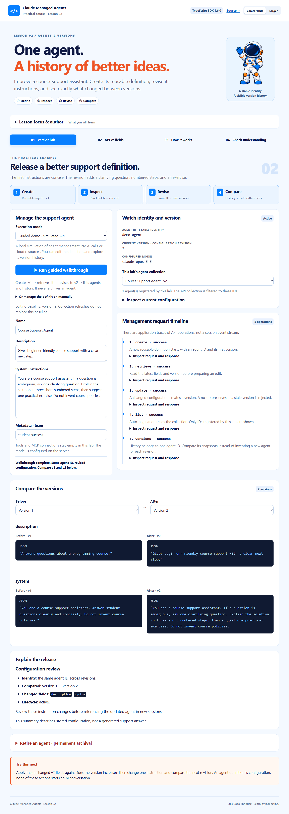
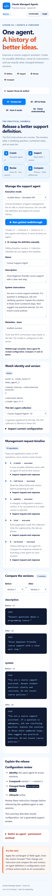

# Shared course visual style

Lesson 2 preserves the approved Lesson 1 interface language:

- Pale blue `#f4f9ff`, navy `#101a44`, orange `#ee5425`, blue `#087fff`.
- Astronaut hero, author/focus disclosure, numbered workflow cards, four activity tabs.
- Rounded control panels, request timeline, highlighted examples, UML architecture and activity diagrams, and a quiz.
- Comfortable/Larger text settings, keyboard tabs, visible focus, responsive stacking, and scrollable wide diagrams.

The lesson-specific workspace replaces the session conversation with a definition editor, version selectors, field-by-field JSON comparison, and configuration review. Every method and field card has an expandable code example.

